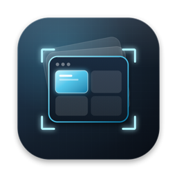

<h1 align="center">开造记 · kaizaoji</h1>

<b>热爱 AI，享受 AI 编程。用 AI 把想法造出来，把日子过得更顺手。</b> 
Building real things with AI — tools, automations and the occasional trip.

  
  
  

---

## 开造记在做什么

「开造」就是动手去造。这里记录的是用 AI 把一个个真实需求做出来的过程：遇到什么问题、怎么用 AI 解决、最后做成了什么工具。每个作品都尽量开源，配套的过程会在视频和文章里分享。

### 主线：AI 实战

用 AI 解决手边真实的问题，而不是只看演示。

- **文件整理**：让 AI 帮你归类、改名、去重，把乱成一团的下载文件夹收拾干净。
- **工作自动化**：把重复的点点点交给脚本和 AI，省下的时间留给真正要想的事。
- **小工具制作**：一个下午做出一个能天天用的小工具，比如下面的窗口图鉴。
- **内容生产**：用 AI 辅助写稿、剪辑、做封面，把想法更快变成作品。

### 辅助：数字工具与搭建

- **个人网站**：从域名、服务器到上线，一步步搭起自己的网站。
- **自动备份**：重要数据多处备份，换电脑、出意外都不慌。
- **个人服务**：自己部署常用服务，数据掌握在自己手里。
- **效率系统**：笔记、命令、窗口、任务，整理成一套顺手的工作流。

### 少量：生活里的 AI

把 AI 带进日常，和主线一样讲究「实测」：比如让 AI 规划一次旅行，再真的按计划走一遍，用旅行 vlog 记录哪些靠谱、哪些翻车。

---

## 作品

<table>
  <tr>
    <td width="88" valign="top"></td>
    <td valign="top">
      <b><a href="https://github.com/kaizaoji/WindowAtlas">窗口图鉴 WindowAtlas</a></b> 
      为 AI 并行编程打造的 macOS 窗口工作台。同时开十几个 Claude Code、Codex、终端和浏览器，也能用实时缩略图一眼找到要的窗口，一键排好位置。免费、MIT 开源。 
      <a href="https://windowatlas.kaizaoji.com">官网</a> · <a href="https://github.com/kaizaoji/WindowAtlas/releases/latest">下载</a> · <a href="https://windowatlas.kaizaoji.com/docs/">文档</a>
    </td>
  </tr>
</table>

更多作品陆续开源中。

---

## 一起交流

- 在各项目的 Issue 里提问题、提需求，你的痛点可能就是下一期的选题。
- 在 X 上关注 [@kaizaoji](https://x.com/kaizaoji)，获取新作品和视频更新。
- 品牌主站 kaizaoji.com 建设中。
- 觉得某个项目有用，欢迎点个 ⭐，这是继续「开造」的最大动力。
